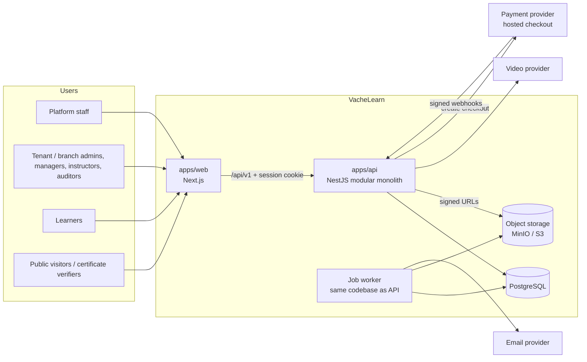
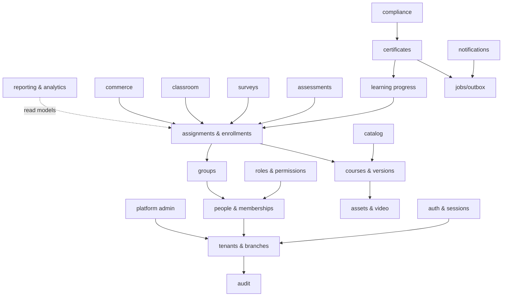

# VacheLearn Architecture — Phase 0 draft

Status: **Proposed** (Phase 0, 2026-10-20), except D-024, D-035, D-052 and D-056, which the owner **Confirmed** on
2026-10-20. Nothing here is built yet. Decision IDs refer to `docs/DECISIONS.md`;
MASTER_PROMPT §4 is the source of the defaults.

## 1. Baseline

| Layer | Proposed choice | Decision |
|---|---|---|
| Repo | pnpm workspaces monorepo: `apps/web`, `apps/api`, `packages/contracts` (Zod schemas + API types), `packages/ui` only once a second consumer exists, `infra/` | D-024, D-035 |
| Runtime | Node.js 26 LTS (from 2026-10-28; fall back to 24 LTS), pnpm current major | D-052 |
| Web | Next.js App Router + TypeScript strict, Tailwind CSS, shadcn/ui, React Hook Form + Zod | D-002 |
| API | NestJS + TypeScript strict, REST `/api/v1`, OpenAPI generated from code (non-prod `/api/docs`) | D-003 |
| Data | PostgreSQL + Prisma; composite tenant FKs; CHECK + partial unique indexes in raw migration SQL; RLS optional in P7 | D-005 |
| Auth | API-owned email + password (Argon2id), opaque server-side sessions in Postgres, httpOnly cookie, CSRF protection, rate limits | D-010 |
| Jobs | Postgres job/outbox table + in-process worker; Redis/BullMQ only on measured need | D-040 |
| Files | `StorageService`: S3-compatible; local server chosen in Phase 3 (MinIO no longer publishes images) | D-009, D-078 |
| Video | `VideoProvider`: `mock` locally; Cloudflare Stream candidate | D-006 |
| Email | `EmailProvider`: console / Mailpit locally | — |
| PDF | `PdfRenderer` (headless Chromium or a PDF library — chosen in P4.6 with a dependency note) | — |
| Payments | `PaymentProvider`, disabled until D-007/D-008/D-029 are Confirmed | D-007 |
| CI | GitHub Actions | D-056 |
| Hosting | Docker images; host TBD (India region preferred for residency) | D-015 |

## 2. System context



The browser never talks to the database, storage keys or providers directly, except media/document downloads through
short-lived signed URLs issued by the API after an authorization check, and the provider's hosted checkout page.

## 3. Modules (bounded contexts) and dependencies

One NestJS module per context (`.claude/rules/api.md`). Arrows mean "may call the exported service of". No module
reads another module's tables.



Every module also depends on `access` (permission + scope checks) and `audit`; those edges are omitted for clarity.
Domain events (e.g. `course.completed` → certificates, compliance, notifications) are written to the outbox in the
same transaction and handled after commit, so a failed side effect never rolls back learning evidence.

## 4. Trust boundaries

| Boundary | Rule |
|---|---|
| Internet → web/API | TLS; CSP, HSTS, frame-ancestors, referrer-policy; CORS allowlist of the web origin only |
| Anonymous → authenticated | Session cookie (httpOnly, Secure, SameSite=Lax) + CSRF token on mutations; rate limits on login, reset, invitation accept, certificate verification |
| User → tenant | Active membership resolved from the **session**, never from client-supplied ids, headers, slugs or bodies |
| Tenant → branch | Branch scope from role assignments, intersected with any client filter; 404 when existence would leak |
| Platform → tenant | Only via audited, time-boxed support session (D-037) |
| Public endpoints | Catalog (public courses only, if D-021), certificate verification (minimal fields, D-017), invitation preview, payment webhooks — explicitly `@Public()` |
| Provider → API | Webhook signature verified on the raw body; `(provider, eventId)` dedup; no entitlement from redirects |
| API → storage | Tenant-prefixed, random object keys; signed URLs short-lived and never logged |

## 5. Request lifecycle

```mermaid
sequenceDiagram
  participant B as Browser
  participant W as Web (Next.js)
  participant A as API (NestJS)
  participant D as Postgres
  B->>W: page request (cookie)
  W->>A: /api/v1/... (forwards cookie, x-request-id)
  A->>A: 1. request id + structured log context
  A->>D: 2. auth guard: session by token hash (revoked/expired/user deactivated → 401)
  A->>A: 3. tenancy guard: active membership from session (tenant suspended → 403 TENANT_SUSPENDED)
  A->>A: 4. permission guard: @RequirePermission key for the route (missing → 403)
  A->>A: 5. validation: Zod schema, unknown fields rejected (→ 422 fieldErrors)
  A->>D: 6. service: queries scoped by tenantId + branch scope (not found / out of scope → 404)
  A->>D: 7. transaction: state change + AuditEvent + outbox rows
  A-->>W: response envelope (data | error with requestId)
  W-->>B: render (API is the authority; UI hides nothing for security)
```

## 6. Authentication design (D-010)

**Proposed:** the API owns identity.

- Email + password, Argon2id; password policy D-051; uniform errors and timing for unknown email vs wrong password.
- Login creates an `AuthSession` row; the browser gets an opaque random token in an httpOnly cookie; only its hash is
  stored. Every request checks the row, so deactivation, password change and suspension take effect on the next
  request (D-049).
- Active tenant is stored on the session; switching tenant is an explicit endpoint that verifies the membership.
- CSRF: SameSite=Lax cookie plus a double-submit or header token on all state-changing requests.
- Email verification and password reset use hashed, single-use, expiring tokens delivered by `EmailProvider`.
  Tokens travel in the URL fragment (`#t=`) on web pages so they never reach server or proxy logs.
- SSO (SAML/OIDC) later via an adapter (Candidate).

| Alternative | Why not the default |
|---|---|
| Auth.js in the web app | Puts identity in the web tier while the API must be the authority; two places to revoke sessions |
| Managed IdP (Clerk, Auth0) | Faster start, but per-MAU cost, data-residency questions for India, and tenant/membership model still lives in our DB |
| Keycloak (self-hosted) | Strong features, high operational burden for a POC with low fixed cost as a goal |
| JWT access tokens | Hard to revoke within D-049's "next request" window without a server-side denylist, which recreates sessions |

## 7. Local development topology

`infra/docker-compose.yml` (Phase 2 slice 2.1):

| Service | Purpose | Port (Proposed) |
|---|---|---|
| postgres | Dev database `vachelearn` + test database `vachelearn_test` | 55432 |
| mailpit | Captures outgoing email; web UI | 51025 / 58025 |

Built in Slice 2.1 (2026-10-27). Host ports avoid the standard 5432/1025/8025 so another local project is never
touched; object storage is added with `StorageService` in Phase 3 (D-078).

`apps/web` on :3000 and `apps/api` on :4000 run on the host (`pnpm dev`).

## 8. Environments

| Environment | Purpose | Data | Secrets |
|---|---|---|---|
| local | Development | Seed data (two demo tenants, clearly fictional) | `.env` written by the developer; never read by Claude |
| test (CI) | Automated gates | Fresh database per run | CI-only placeholders |
| staging | Pre-release verification, restore tests | Seed or anonymised data only | Secret manager, separate from production |
| production | Live tenants | Real data | Secret manager; access audited |

Configuration is validated at boot from a schema; the app fails fast on missing or malformed variables.
`.env.example` lists every name with a placeholder.

## 9. Repository layout (target)

```text
apps/
  web/                # Next.js — route groups per role (see .claude/rules/web.md)
  api/                # NestJS — one module per bounded context; prisma/ for schema + migrations
packages/
  contracts/          # Zod schemas, API types, error codes shared by web and api (D-035)
  ui/                 # only when a second consumer exists
infra/                # docker-compose.yml, Dockerfiles, deploy assets
docs/ · prompts/ · assets/ · reference/
```
