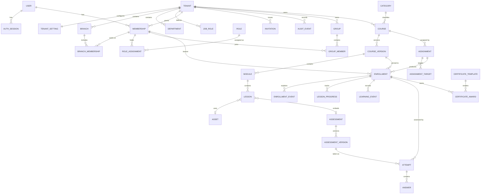

# VacheLearn Domain Model — Phase 0 draft

Status: **Proposed** (Phase 0, 2026-10-20). Conceptual model only — no Prisma schema yet. The physical schema is
written slice by slice from Phase 2 and this file is updated in the same change. Sources: MASTER_PROMPT §6, spec §3
and §4–§15, `docs/LEGACY_CAPABILITY_INVENTORY.md`. Decision IDs refer to `docs/DECISIONS.md`.

## 1. Classification rules

- **Global** — not owned by one tenant. Never reachable through a tenant route except via the actor's own record.
- **Tenant-owned** — `tenant_id NOT NULL`, `@@unique([tenantId, id])`, every relation to another tenant-owned model
  is a composite FK `(tenant_id, x_id) → x(tenant_id, id)` (`.claude/rules/database.md`).
- **Branch-scoped** — tenant-owned **and** visibility to branch-scoped actors depends on a branch. Either the row
  stores `branch_id` directly (*direct*), or branch is derived through the learner's branch memberships (*derived*,
  semantics pending **D-026**).
- **Evidence** — insert-only from the application; corrections are new rows referencing the old one.

Naming: auth sessions are `AuthSession`; classroom sessions are `ClassSession` (MASTER_PROMPT §6).
Spec §3 names that differ: `ProgressRecord` → `LessonProgress`; `SessionEnrollment` → `SessionRegistration`;
`InstructorAssignment` → `SessionInstructor`; `Product/Offer` → `Offer`. `GradingResult` (spec) is folded into
`Attempt` (score, passed, grading status) until manual grading exists. `ContentProviderRef` (spec) becomes
`Asset.provider` + `Asset.providerRef`.

## Physical schema (built so far)

`apps/api/prisma/schema.prisma` + `apps/api/prisma/migrations/` are the source of truth; this section records what is
built and the guarantees the database itself enforces.

| Table | Slice | Class | Database guarantees |
|---|---|---|---|
| `tenants` | 2.2 | Global | `slug` unique and CHECK-formatted (D-079); suspended/archived rows must record when and why (CHECK); `version` for optimistic concurrency; UUID v7 ids (`uuidv7()`, Postgres 18) |
| `tenant_settings` | 2.2 | Tenant-owned (1:1) | Five feature flags, all false by default (D-031) |
| `branches` | 2.2 | Tenant-owned | `(tenant_id, id)` unique (target of composite FKs); `(tenant_id, code)` unique; code CHECK-formatted, uppercase; inactive rows must record when and why |
| `audit_events` | 2.2 | Evidence | Insert-only (trigger rejects UPDATE/DELETE); `(tenant_id, branch_id) → branches(tenant_id, id)` composite FK plus CHECK `branch_id IS NULL OR tenant_id IS NOT NULL` (a NULL would skip the FK); `actor_user_id` gets its FK to users in 2.3 |
| `jobs` | 2.3a | Global (platform-internal; optional `tenant_id` FK) | `(type, business_key)` unique (enqueue is idempotent); status enum `queued/running/retrying/succeeded/failed`; CHECKs: `running` ⇔ locked, `succeeded/failed` ⇔ `completed_at`, `attempts` between 0 and `max_attempts` (1–20), `type` formatted `resource.action`; `last_error` ≤ 500 characters, sanitised by the runner; payload never holds secrets (D-081) |
| `email_deliveries` | 2.3a | Global (one per email job) | `job_id` unique (one delivery per job → a retry after sending does not resend); `sent` ⇔ `sent_at` (CHECK); holds Message-ID and provider only — no address or body |

Not built yet: everything else in §2 (Department waits for D-047 in 2.5).

## 2. Entity inventory

Release: R1 = Phase 2 · R2 = Phases 3–4 · R3 = Phase 5 · R4 = Phase 6.

### Tenancy and identity (R1)

| Entity | Class | Key fields | Uniqueness / notes |
|---|---|---|---|
| Tenant | Global | id, slug, displayName, status, defaultTimezone, defaultLocale, suspendedAt/Reason/ById, archivedAt (+ D-048 fields) | `slug` unique globally; rename never changes id |
| TenantSetting | Tenant-owned | tenantId (PK/FK), typed columns: learning defaults, catalog visibility (D-021), invitation expiry (D-050), feature flags (D-031), `version` | One row per tenant; optimistic concurrency |
| TenantBranding | Tenant-owned | logo asset, primary colour (contrast-checked), certificate defaults, `version` | One row per tenant; R2 (needs storage) |
| TenantDomain | Tenant-owned | hostname, verifiedAt | Only if D-021 enables custom domains; not R1 |
| Branch | Tenant-owned, direct (itself) | code, name, address, timezone, status, deactivatedAt | `(tenant_id, code)` unique |
| Department | Tenant-owned | name, code?, status | `(tenant_id, name)` unique; D-047 |
| JobRole | Tenant-owned | name, status | `(tenant_id, name)` unique; for compliance applicability (D-047) |
| User | Global | email (citext), displayName, passwordHash, emailVerifiedAt, locale, timezone, status, deactivatedAt | `email` unique globally; never deleted if it has learning history |
| AuthSession | Global | userId, tokenHash, activeTenantId?, activeMembershipId?, createdAt, lastSeenAt, expiresAt, revokedAt, reason | Opaque token; only the hash is stored (D-010) |
| EmailVerificationToken, PasswordResetToken | Global | userId, tokenHash, expiresAt, usedAt | Single-use, hashed |
| Membership | Tenant-owned | userId (global FK), status (`invited`→`active`→`deactivated`), employeeId?, departmentId?, jobRoleId? | `(tenant_id, user_id)` unique; `(tenant_id, employee_id)` unique where not null |
| BranchMembership | Tenant-owned, direct | membershipId, branchId, isPrimary | `(tenant_id, membership_id, branch_id)` unique; exactly one primary per membership (partial unique) — D-026 |
| Role | Global | key (`tenant_admin`, …), name, scopeLevel | 7 fixed system roles (D-053) |
| Permission | Global | key (`course.publish`) | Code registry mirrored in `ROLE_PERMISSION_MATRIX.md` |
| RoleAssignment | Global for platform scope; Tenant-owned otherwise | userId/membershipId, roleId, scopeType (`platform`/`tenant`/`branch`), branchId?, grantedById, revokedAt/ById | One active assignment per (membership, role, scope); changes audited |
| Invitation | Tenant-owned, direct (branchId?) | email, intendedRoleId, branchId?, groupId?, tokenHash, expiresAt, invitedById, status (`pending`/`accepted`/`revoked`/`expired`), acceptedAt, acceptedByUserId | Token hash unique; at most one pending per `(tenant_id, lower(email))` |
| PlatformSupportSession | Global | staffUserId, tenantId, reason, startedAt, expiresAt, endedAt, accessLevel | D-037; every action inside is audited with the support session id |
| AuditEvent | Evidence; Tenant-owned when tenantId set, else platform | actorUserId, tenantId?, branchId?, action, entityType, entityId, requestId, supportSessionId?, before/after (safe subset), occurredAt | Insert-only |

### Targeting and content (R2)

| Entity | Class | Key fields | Uniqueness / notes |
|---|---|---|---|
| Group | Tenant-owned, direct (branchId? / departmentId?) | name, description, status | `(tenant_id, name)` unique among active |
| GroupMember | Tenant-owned | groupId, membershipId, addedAt/ById, removedAt/ById | Removal sets `removedAt` (history kept); one active row per (group, member) |
| Category, Tag | Tenant-owned | name, slug | `(tenant_id, slug)` unique |
| Course | Tenant-owned | slug, ownerMembershipId, categoryId, status (`active`/`archived`), archivedAt, currentPublishedVersionId?, selfEnrollment (D-046) | `(tenant_id, slug)` unique |
| CourseVersion | Tenant-owned | courseId, versionNumber, status, metadata snapshot (title, summary, description, level, language, duration, delivery mode, visibility, objectives, audience, prerequisites), completionPolicy, publishedAt/ById, `version` (concurrency) | `(tenant_id, course_id, version_number)` unique; at most one `draft` per course (partial unique); immutable once `published` |
| Module, Lesson | Tenant-owned | courseVersionId, position, title; Lesson: type (`text`/`video`/`document`/`link`/`assessment`), required, completionRule (D-041), assetId?, assessmentId? | `(course_version_id, position)` unique; frozen with the version |
| Asset | Tenant-owned | kind, storageKey (`tenants/{tenantId}/{kind}/{uuid}`), contentType (sniffed), sizeBytes, sha256, provider, providerRef, processingStatus (`uploading`/`processing`/`ready`/`failed`) | Storage key unique; never exposed except via signed URL |
| CompletionPolicy | Value object on CourseVersion | requiredLessons (all required / listed), requiredAssessmentId?, attendanceRequired (R3) | Frozen with the version (D-016) |

### Learning evidence (R2)

| Entity | Class | Key fields | Uniqueness / notes |
|---|---|---|---|
| Assignment | Tenant-owned | courseId, courseVersionPolicy (`current`), requirement (`mandatory`/`optional`), dueAt?, priority, reminderPolicy?, createdById, status (`active`/`cancelled`), idempotencyKey | `(tenant_id, idempotency_key)` unique |
| AssignmentTarget | Tenant-owned | assignmentId, targetType (`user`/`group`/`branch`/`tenant` — D-045), targetId | Validated against actor scope at creation |
| Enrollment | Tenant-owned, derived (learner's branches) | membershipId (learner), courseVersionId, source (`assignment`/`self`/`purchase`/`session`), sourceRefId, status (`not_started`/`in_progress`/`completed`/`cancelled`), dueAt?, enrolledAt, startedAt, completedAt, cancelledAt/Reason/ById | Partial unique: one non-cancelled enrollment per `(tenant_id, membership_id, course_version_id)`. Reuse policy (Proposed, D-045): a second source records an EnrollmentEvent `source_added` on the existing enrollment and the earliest due date applies. **Overdue is derived** (D-054) |
| EnrollmentEvent | Evidence | enrollmentId, type (`created`, `due_changed`, `cancelled`, `migrated`, `source_added`…), actor, payload (safe), occurredAt | Explains "why does this enrollment exist" |
| LessonProgress | Tenant-owned (latest state, upsert) | enrollmentId, lessonId, status, positionSeconds?, percentWatched?, acknowledgedAt?, completedAt | `(enrollment_id, lesson_id)` unique; completion never reverts |
| LearningEvent | Evidence | enrollmentId, type (`lesson_started`, `lesson_completed`, `assessment_submitted`, `course_completed`, `certificate_awarded`…), idempotencyKey, occurredAt | `(tenant_id, idempotency_key)` unique — duplicates are no-ops |
| QuestionBank, Question, QuestionOption | Tenant-owned | type (`single`/`multiple`/`true_false`), stem, points, options with `isCorrect` | Editable; snapshotted into AssessmentVersion |
| Assessment | Tenant-owned | title, ownerId, status | — |
| AssessmentVersion | Tenant-owned | assessmentId, versionNumber, questions snapshot, passMark, attemptLimit, timeLimitSeconds?, answerKeyVisibility (D-023), frozenAt | Frozen at first attempt; edits create a new version |
| Attempt | Evidence (state machine, then immutable) | enrollmentId, assessmentVersionId, attemptNumber, status, startedAt, deadlineAt?, submittedAt, scorePoints, scorePercent (NUMERIC(4,1), D-042), passed, timedOut (D-055) | `(enrollment_id, assessment_version_id, attempt_number)` unique; partial unique on `(enrollment_id, assessment_version_id) WHERE status = 'in_progress'` (one open attempt); limit (D-073: none after a pass) enforced in one transaction with a row lock on the enrollment + `Idempotency-Key`; an open attempt past `deadlineAt` is graded on next read (D-055) |
| Answer | Evidence | attemptId, questionId, selectedOptionIds | One per (attempt, question); `savedAt`; writes only while the attempt is `in_progress` and before `deadlineAt` (+ D-055 grace), else 409 `ATTEMPT_CLOSED`; question/option ids validated against the version (`answerIssues`) |
| CertificateTemplate (+ version) | Tenant-owned | name, layout, placeholders, versionNumber, publishedAt | Award references the template version |
| CertificateAward | Evidence | enrollmentId, membershipId, courseVersionId, completionEventId, templateVersionId, cycle, issuedAt, expiresAt?, verificationId (opaque, random), artifactKey, artifactSha256, snapshot JSON, status (`valid`/`revoked`/`superseded`), revokedAt/Reason/ById, supersededById | `(tenant_id, enrollment_id, cycle)` unique; `verification_id` unique globally (80 CSPRNG bits, D-075); `supersededById` → same tenant **and same user** (composite FK + check); **Expired** is derived from `expiresAt`; revocation reason never public (D-017) |

### Operations (R3) and commerce/analytics (R4)

| Entity | Class | Key fields | Uniqueness / notes |
|---|---|---|---|
| TrainingRequirement | Tenant-owned | courseId, versionPolicy, dueRule, dueSoonDays, validityDays?, effectiveFrom/To, policyVersion | D-018 |
| RequirementApplicability | Tenant-owned | requirementId, type (`tenant`/`branch`/`group`/`department`/`job_role`), targetId | — |
| ComplianceEvidence | Evidence | requirementId, membershipId, enrollmentId/certificateAwardId, policyVersion, satisfiedAt, validUntil | Status (Compliant, Due Soon, Overdue, Not Started, Not Applicable) is **computed**, not stored |
| Survey, SurveyVersion, SurveyQuestion | Tenant-owned | audience, window, anonymity (`anonymous`/`identified`, D-020), multipleResponses, attachment | Version frozen at first response |
| SurveyResponse, SurveyAnswer | Evidence | anonymous mode: **no** membershipId, coarse `submittedOn` date only; eligibility tracked in a separate `SurveyParticipation` (who responded, not what) | `SurveyParticipation (survey_version_id, membership_id)` unique unless multiple responses allowed |
| Venue | Tenant-owned, direct | branchId, name, capacity | — |
| ClassSession | Tenant-owned, direct | courseVersionId, branchId?, venueId? / meetingUrl, startAt, endAt, timezone, capacity, registrationOpensAt/ClosesAt, status | CHECK `end_at > start_at`, `capacity >= 0` |
| SessionInstructor | Tenant-owned | classSessionId, membershipId | Instructor scope source |
| SessionRegistration | Tenant-owned | classSessionId, membershipId, status (`registered`/`cancelled`/`waitlisted` if D-019) | One active per (session, member); capacity enforced under lock |
| AttendanceRecord | Evidence | classSessionId, membershipId, status (Present/Absent/Late/Excused), recordedById, recordedAt, supersedesId? | Edits are new rows |
| Offer, Price | Tenant-owned | courseId, amountMinor (BIGINT), currency CHAR(3), taxDisplay (D-029), activeFrom/To | CHECK `amount_minor >= 0` |
| Order, OrderLine | Tenant-owned | membershipId, status, totals (minor units), currency, idempotencyKey | `(tenant_id, idempotency_key)` unique |
| PaymentAttempt, Refund | Evidence | orderId, provider, providerRef, amountMinor, currency, status | — |
| ProviderEvent | Global (tenantId resolved after verification) | provider, eventId, receivedAt, verifiedAt, processedAt, payloadDigest | `(provider, event_id)` unique; raw payload not stored |
| Entitlement | Tenant-owned | orderLineId, membershipId, courseId, grantedAt, revokedAt (D-008) | Creates Enrollment(source=`purchase`) |
| MetricDefinition, SavedReport, ReportRun, ReportExport | Tenant-owned | definition (governed dimensions/metrics/filters), ownerId, scope snapshot, status, fileKey | Export records requester, scope, filters |
| Job (outbox) | Global with optional tenantId | type, businessKey, payload (no secrets), status (`queued`/`running`/`succeeded`/`failed`/`retrying`), attempts, runAfter, lastError (sanitised) | `(type, business_key)` unique |
| Notification, NotificationDelivery | Tenant-owned | membershipId, type, channel, status, attempts | Delivery idempotent per (notification, channel) |

## 3. Lifecycle state tables

### Course and CourseVersion

| Entity | From | Action (endpoint) | To | Guard |
|---|---|---|---|---|
| CourseVersion | — | create course / edit published | `draft` | Only one draft per course |
| CourseVersion | `draft` | submit for review (only if D-022) | `in_review` | Reviewer permission to approve |
| CourseVersion | `draft` (or `in_review`) | publish | `published` | Metadata valid, ≥1 valid lesson, visibility + completion policy set; assigns next `versionNumber`; sets course `currentPublishedVersionId` |
| CourseVersion | `draft` | discard | (deleted) | Allowed only for never-published drafts (not evidence) |
| CourseVersion | `published` | — | — | **Immutable**; no endpoint may change it |
| Course | `active` | archive | `archived` | Blocks new enrollments; existing evidence untouched |
| Course | `archived` | restore | `active` | Audited |

Display status for a course: Draft (no published version) · Published · Archived (UI status vocabulary).

### Enrollment

| From | Event | To | Notes |
|---|---|---|---|
| — | assignment fan-out / self / purchase / session | `not_started` | Idempotent on the partial unique key |
| `not_started` | first lesson started | `in_progress` | |
| `not_started`, `in_progress` | completion policy satisfied | `completed` | Recorded once (LearningEvent idempotency) |
| `not_started`, `in_progress` | cancel (with reason) | `cancelled` | Progress actions then rejected; evidence kept |
| `completed` | — | — | Terminal; renewal creates a new enrollment cycle (R3) |
| any | migrate version (D-011, explicit + audited) | same status on new version | Old enrollment marked `cancelled` with reason `migrated`, new one linked |

Derived display: **Overdue** = `dueAt` passed (tenant timezone) and status ∉ {completed, cancelled} (D-054).

### Attempt

| From | Event | To |
|---|---|---|
| — | start (`POST /assessments/{id}/attempts`) — limit check under lock | `in_progress` |
| `in_progress` | submit, or deadline passed per D-055 | `submitted` |
| `submitted` | server scoring (same transaction for objective questions) | `passed` or `failed` |

### CertificateAward

| From | Event | To |
|---|---|---|
| — | award job (idempotent per enrollment + cycle) | `valid` |
| `valid` | revoke (reason, actor) | `revoked` |
| `valid` | reissue (explicit, audited) | `superseded` (new award `valid`) |

Derived: **Expired** when `expiresAt` < now. Verification shows Valid · Expired · Revoked · Superseded.

### Invitation

| From | Event | To |
|---|---|---|
| — | create | `pending` |
| `pending` | accept (email + tenant match, not expired) | `accepted` |
| `pending` | revoke / resend (resend revokes old, creates new) | `revoked` |
| `pending` | expiry passes | `expired` (derived on read; may be materialised by a job) |

### ClassSession and SessionRegistration (R3)

| Entity | From | Event | To |
|---|---|---|---|
| ClassSession | — | create | `scheduled` |
| ClassSession | `scheduled` | end time passes + attendance recorded | `completed` |
| ClassSession | `scheduled` | cancel (reason) | `cancelled` |
| ClassSession | `cancelled` | reopen (explicit, audited) | `scheduled` |
| SessionRegistration | — | register (capacity under lock) | `registered` (or `waitlisted` if D-019) |
| SessionRegistration | `registered` | cancel within policy | `cancelled` |

### Order (R4)

| From | Event | To |
|---|---|---|
| — | create (server-priced, idempotency key) | `pending` |
| `pending` | verified provider event: paid | `paid` (Entitlement granted) |
| `pending` | verified provider event: failed / user cancel | `failed` / `cancelled` |
| `paid` | verified refund event | `refunded` / `partially_refunded` (D-008 access policy) |

### Tenant, Branch, Membership

Tenant: `active` ⇄ `suspended` (reason, audited) → `archived`. Branch: `active` ⇄ `inactive`. Membership:
`invited` → `active` ⇄ `deactivated`. Suspension and deactivation revoke sessions on the next request (D-049).

## 4. Idempotency keys

| Operation | Key |
|---|---|
| Assignment create | `Idempotency-Key` header → `Assignment.idempotencyKey` |
| Assignment fan-out | Enrollment partial unique `(tenant, membership, course_version)` where not cancelled |
| Progress events | client-generated event id → `LearningEvent.idempotencyKey` |
| Course completion | LearningEvent `course_completed:{enrollmentId}` |
| Certificate award | `(tenant, enrollment, cycle)` unique + job business key |
| Order create | `Idempotency-Key` header → `Order.idempotencyKey` |
| Webhooks | `ProviderEvent (provider, event_id)` |
| Jobs | `Job (type, business_key)` |
| Notifications | `NotificationDelivery (notification, channel)` |

## 5. Immutability rules

- `CourseVersion` (status `published`), its Modules, Lessons and CompletionPolicy.
- `AssessmentVersion` once `frozenAt` is set (first attempt).
- `CertificateTemplate` versions once used by an award; `CertificateAward` snapshot, artifact and hash.
- `SurveyVersion` after the first response.
- Evidence tables (insert-only): AuditEvent, EnrollmentEvent, LearningEvent, Attempt (after submit), Answer (after
  submit), CertificateAward (status changes only via revoke/supersede columns), AttendanceRecord, SurveyResponse,
  SurveyAnswer, ComplianceEvidence, PaymentAttempt, Refund, ProviderEvent.
- Legacy anti-patterns are not carried forward: no `custom0..4`, no generic `access` JSON, no plaintext credentials.

## 6. ER diagram — R1 + R2 entities

## 7. Open points this model depends on

D-026 (branch derivation for learners) · D-045 (cohort targets) · D-046 (self-enrollment) · D-047/D-048 (profile
fields) · D-053 (fixed roles) · D-054 (derived overdue) · D-055 (time-limit expiry) · D-011 (version migration) ·
D-016/D-041 (completion rules) · D-022 (review state).
