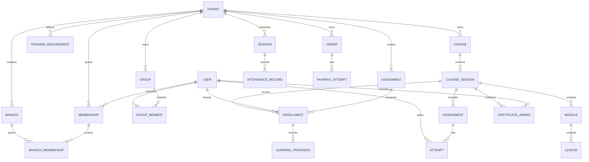

# VacheLearn Domain Model — Initial Proposal

> **Pre-Phase-0 draft (kit v1.0), not yet reconciled.** Phase 0 rewrites this file. Until then `MASTER_PROMPT.md`
> wins on conflicts — notably, auth sessions are `AuthSession` and classroom sessions are `ClassSession`; the
> `Session` entries below predate that rename.

## Main entity groups

### Tenancy and identity
Tenant, Branch, Department, TenantDomain, TenantSetting, User, Membership, BranchMembership, Role, Permission, RoleAssignment, Invitation, Session.

### Groups and targeting
Group, GroupMember, Assignment, AssignmentTarget.

### Content
Course, CourseVersion, Module, Lesson, Asset, Category, Tag, ContentProviderRef.

### Learning evidence
Enrollment, LearningProgress, LearningEvent, Assessment, AssessmentVersion, Question, QuestionOption, Attempt, Answer, GradingResult.

### Certificates and compliance
CertificateTemplate, CertificateAward, TrainingRequirement, RequirementApplicability, ComplianceEvidence.

### Surveys and classroom
Survey, SurveyVersion, SurveyQuestion, SurveyResponse, SurveyAnswer, Session, SessionEnrollment, AttendanceRecord, InstructorAssignment, Venue/MeetingLink.

### Commerce and reporting
Offer, Price, Order, OrderLine, PaymentAttempt, Refund, ProviderEvent, SavedReport, ReportRun, ReportExport, MetricDefinition, AuditEvent.

## Conceptual relationship diagram

## Integrity rules
- Use stable UUID primary keys for new records unless external provider requirements differ.
- Enforce foreign keys and unique constraints for tenant ownership and memberships.
- Tenant-owned records must have an auditable tenant ownership path.
- Branch-scoped access must be represented explicitly.
- Published course and assessment versions are immutable.
- Store timestamps in UTC.
- Preserve historical progress, attempts, awards, attendance and payment events.
- Do not blindly map legacy `custom0`–`custom4` or generic JSON access fields into the new domain model; profile usage first.
- This is a conceptual model; finalize physical schema and migrations during implementation.
